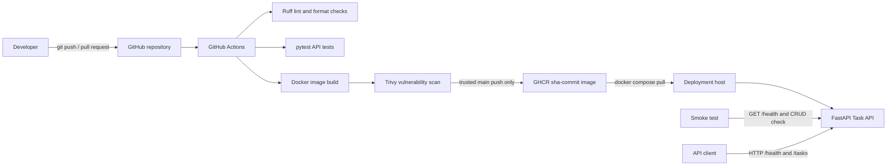
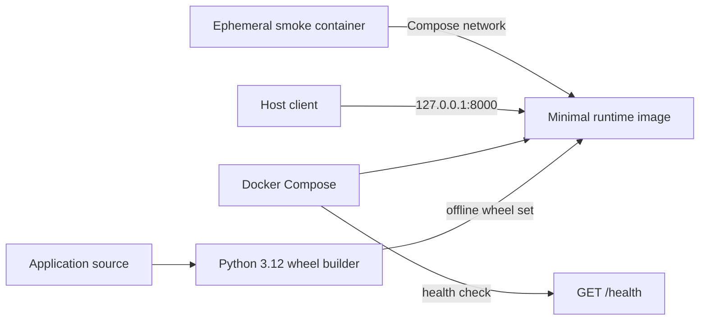

# Architecture

## System Context

DeployFlow is intentionally a single-service application. The Task API provides a small, testable workload while the portfolio project demonstrates the delivery controls around it.

The local container build, Compose deployment, health check, and smoke-test path are implemented in M2. GitHub Actions quality checks, image builds, and Trivy scanning are implemented in M3. M4 implements trusted-branch GHCR publishing, explicit version deployment, post-deployment smoke tests, and rollback; actual remote publication and deployment require approval.

## Runtime Design

The FastAPI process exposes:

- `GET /health` for runtime health checks.
- `GET /tasks` and `GET /tasks/{id}` for reads.
- `POST /tasks`, `PUT /tasks/{id}`, and `DELETE /tasks/{id}` for writes.
- `/docs` for generated OpenAPI documentation.

Tasks are stored in a thread-safe in-memory repository. State is process-local and is lost when the process restarts. This is deliberate for the CI/CD MVP: it removes database operations from the critical path and keeps attention on build, verification, publishing, deployment, and rollback.

## Container Runtime

The Dockerfile uses a pinned Python 3.12.16 slim Bookworm image digest in both stages. The builder resolves and builds application wheels; the runtime installs only from that wheel set and does not contain source-control metadata, tests, documentation, or build tools.

The runtime process uses UID/GID `10001`, not root. Compose binds the API only to host loopback, makes the root filesystem read-only, mounts a small temporary `/tmp`, drops all Linux capabilities, enables `no-new-privileges`, limits process count, and waits for an application-level health check.

## Continuous Integration

GitHub Actions runs on pull requests and pushes to `main`. The quality job executes Ruff lint, Ruff formatting verification, and pytest on Python 3.12. The container-security job runs only after quality succeeds, builds the same Dockerfile with a commit-specific local tag, and scans the resulting image with Trivy. No CI step authenticates to a registry or publishes an image.

The workflow grants only `contents: read`, does not persist checkout credentials, and pins all external actions to immutable full commit SHAs. Fixed `ubuntu-24.04` runners, explicit tool versions, job timeouts, and concurrency cancellation reduce environmental drift and wasted runner time.

Trivy scans OS and Python packages using vulnerability data available at workflow runtime. The gate fails for fixable `HIGH` or `CRITICAL` findings, ignores unfixed findings, and reports results in the job log. This policy prioritizes actionable release-blocking risk while keeping the MVP operational; it must be reconsidered before production use.

## Publishing, Deployment, and Rollback

The publish job is gated at job level to pushes on `refs/heads/main` and depends on successful quality and container-security jobs. Only that job receives `packages: write`; pull-request jobs retain read-only repository access and cannot reach registry authentication. The publish candidate is rebuilt, scanned, labeled with its source and revision, and tagged as `sha-<40-character-commit>`.

Before pushing, the workflow authenticates with the repository-scoped `GITHUB_TOKEN` and queries GHCR. An existing tag causes a hard failure, and ambiguous registry errors fail closed. No mutable branch or `latest` tag is published.

Deployment sets `DEPLOYFLOW_IMAGE` to one explicit GHCR commit tag, pulls it, and starts Compose with `--no-build`. Health and full CRUD smoke tests run before the version is accepted. Rollback supplies the previous known-good tag to the identical deployment path, so rollback never rebuilds source. Task data remains ephemeral and is lost whenever a container is replaced.

## Design Decisions

### Single service

A modular monolith is sufficient for one small bounded context. Microservices would add network, deployment, and observability complexity without improving the portfolio evidence.

### Application factory

`create_app` accepts a repository instance. Tests receive isolated state without global resets or external services, while production uses a default in-memory repository.

### Replace semantics for updates

`PUT /tasks/{id}` requires a complete mutable task representation. This keeps the contract explicit. Partial updates can be introduced later only if a real client requires `PATCH`.

### Immutable response models

Stored task models are immutable. Updates create a new value, reducing accidental mutation of shared in-memory state.

### Versioned container images

M4 publishes only commit-derived tags to GHCR. Deployments reference an explicit tag so rollback means redeploying a previously verified image rather than rebuilding source. Workflow checks prevent accidental tag reuse; package administrators must also avoid manual overwrites.

### Container health and smoke testing

The Compose health check runs inside the application container using Python's standard library, so no shell utility such as curl is added to the production image. The external smoke test verifies health and the complete CRUD lifecycle through HTTP, then deletes its task so repeated runs remain isolated.

### Runtime hardening

The image defines the non-root identity; Compose supplies host-specific runtime restrictions. Keeping these concerns separate allows the same immutable image to run under stricter deployment policies later without rebuilding application code.

### Security boundary

No secret belongs in the image or repository. GitHub authentication will use repository-provided tokens with least-privilege workflow permissions. Trivy will scan the final image before publication or deployment.
